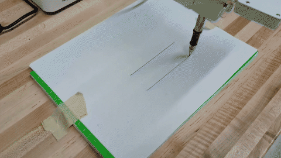

# Tic-tac-toe robot

<p align="center">
  
</p>

You play tic-tac-toe against a Dobot Magician Lite on real paper with a pen. The robot draws the grid, watches your move with a camera, picks its move, and draws it.

I built this for RAS 545 Robotic Systems I at Arizona State University, Fall 2025. I also got to demo it at an ASU Halloween outreach event, where visiting school students could win a prize if they beat a robot. Mine didn't lose a game that day.

[](https://www.youtube.com/watch?v=ukr_7SG5Fbk)

## How a game goes

1. The robot draws a 3x3 grid with 35 mm cells.
2. You always go first. Draw an X or an O in any cell, and the robot plays the other symbol.
3. The arm moves to a fixed camera pose and takes a picture.
4. It finds the new mark by comparing the picture with the board it already knows.
5. It picks its move with minimax and draws it. An O is drawn as a 12-sided circle.
6. When the game ends, it strikes through the winning line, or writes a D next to the grid for a draw.

## Vision

- **O** is detected with HoughCircles and **X** with template matching, cell by cell.
- The camera sees the board rotated 90 degrees from where the player sits, so every detection is mapped back to the player's view before the game logic sees it.
- If no new mark shows up, or two new marks show up in one turn, it doesn't guess. It asks to capture again (and you can fall back to typing the cell number). There's also a routine in `robot_moves.py` to draw an E next to the grid for this case.

## Why it doesn't lose

The AI is minimax with alpha-beta pruning, and it scores faster wins higher and slower losses lower. I checked every possible game where the human starts (569 of them) and the robot never loses. The best you can get is a draw.

## Files

| File | What it does |
|---|---|
| `main.py` | Runs the game: setup, turns, win/draw handling |
| `vision_module.py` | Camera alignment, grid cells, X/O detection, rotation mapping |
| `game_logic.py` | Board, winner check, minimax |
| `robot_moves.py` | Drawing lines, X, O, D, E and the strike line with pen up/down. Also a simulator so it runs without the robot |
| `draw_grid.py` | Draws just the grid, useful for tuning the pen height |
| `config.py` | Grid position, cell size, pen heights, camera pose, speeds |

## Running it

```bash
pip install -r requirements.txt
python draw_grid.py   # check the pen touches the paper but doesn't drag
python main.py
```

Set `USE_ROBOT = True` in `config.py` on the real arm. With it off, it uses the simulator and just prints the moves. The coordinates and pen heights are from my lab table, so tune `DRAW_Z` and `DRAW_TRAVEL_Z` first: if the pen drags, raise the travel height, and if it skips, lower the draw height.
